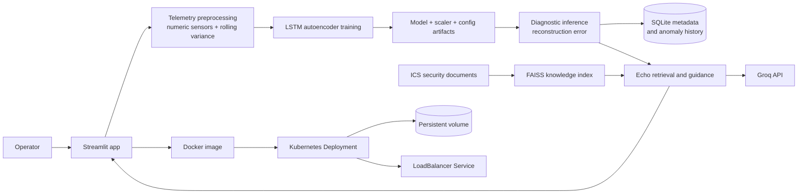

# Argus Echo

**Industrial telemetry anomaly detection with retrieval-grounded operator guidance.**

Argus Echo trains facility-specific anomaly detectors from normal telemetry, analyzes new sensor data, and provides operator guidance grounded in industrial control system (ICS) security documents.

<a href="https://www.loom.com/share/ae84ea9d2b4740f680059a0cd4ee66a7"></a>

## Project at a glance

| Area | What this project demonstrates |
| --- | --- |
| AI/ML | LSTM autoencoder for time-series anomaly detection; telemetry preprocessing; rolling variance features; model, scaler, and configuration artifacts |
| MLOps | Per-user model records and artifacts; repeatable training and inference paths; row limits; health probes; persistent storage; a container build workflow |
| DevOps | Docker image; Kubernetes Deployment, Service, namespace, and persistent volume claim; resource requests and limits; readiness and liveness probes |
| Applied AI | Retrieval-augmented ICS guidance using a local vector index and Groq generation |

## User workflow

1. Create an account or log in.
2. Upload normal-operation telemetry and train a facility-specific LSTM autoencoder.
3. Upload telemetry for diagnostics and review reconstruction-error anomalies and history.
4. Ask Echo for an explanation grounded in the indexed ICS security corpus.

## Architecture



The application runs as a single Kubernetes replica. SQLite and user artifacts are stored on a persistent volume.

## Repository map

```text
.
├── app.py                      Streamlit UI and user workflows
├── argus_model.py              Telemetry preprocessing and LSTM training
├── persistence.py              SQLite users, model metadata, and run history
├── argus_logger.py             Anomaly hint and local logging helpers
├── train_model.py              Command-line training entry point
├── echo/                       Retrieval, indexing, embeddings, and evaluation
├── data/                       ICS security and anomaly-detection references
├── k8s/                        Kubernetes namespace, deployment, and service
├── .github/workflows/          Container build automation
├── Dockerfile                  Runtime container definition
└── requirements*.txt           Development and container dependencies
```

## Run locally

Requires Python 3.10+ and a Groq API key for generated Echo responses. Core model training and diagnostics do not require that key.

```powershell
python -m venv .venv
.\.venv\Scripts\Activate.ps1
pip install -r requirements.txt
$env:ARGUS_STORAGE_DIR = "ml"
$env:ARGUS_DB_PATH = "ml\argus_echo.db"
$env:GROQ_API_KEY = "your_groq_api_key"
streamlit run app.py
```

The app opens at `http://localhost:8501`. The local storage directory is ignored by Git.

## Build and deploy

GitHub Actions builds the Docker image on pushes to `main` and pull requests. It does not publish to a registry or deploy to a cloud account; deployment remains an explicit operator action.

```powershell
docker build -t argus-echo:local .
docker run --rm -p 8501:8501 -e GROQ_API_KEY=your_groq_api_key argus-echo:local
```

The Kubernetes manifests are in `k8s/`. Configure `GROQ_API_KEY` as a Kubernetes Secret before deploying; `k8s/secret.example.yaml` is only a placeholder template.

## Model and data notes

- Timestamp, date, time, and label-like columns are dropped; numeric sensor columns are retained.
- Rolling variance features are added per sensor.
- Training and diagnostic files must produce the same feature layout.
- Training and inference row caps default to 20,000 and can be configured through `ARGUS_MAX_TRAINING_ROWS` and `ARGUS_MAX_DIAGNOSTIC_ROWS`.
- User identity and operational metadata use SQLite; trained models and generated data live on local or mounted storage.

## Technology

Python · pandas · NumPy · TensorFlow/Keras · scikit-learn · Streamlit · SQLite · FAISS · LangChain · Groq · Docker · Kubernetes · Google Kubernetes Engine
