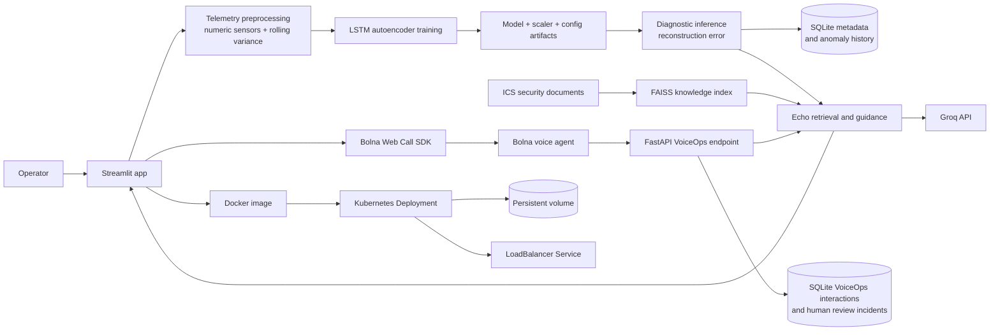

# Argus Echo

**Industrial telemetry anomaly detection and Bolna-powered voice incident decision support.**

Argus Echo trains facility-specific anomaly detectors from normal telemetry, analyzes new sensor data, and provides operator guidance grounded in industrial control system (ICS) security documents.

<a href="https://www.loom.com/share/ae84ea9d2b4740f680059a0cd4ee66a7"></a>

## Project at a glance

| Area | What this project demonstrates |
| --- | --- |
| AI/ML | LSTM autoencoder for time-series anomaly detection; telemetry preprocessing; rolling variance features; model, scaler, and configuration artifacts |
| MLOps | Per-user model records and artifacts; repeatable training and inference paths; row limits; health probes; persistent storage; a container build workflow |
| DevOps | Docker image; Kubernetes Deployment, Service, namespace, and persistent volume claim; resource requests and limits; readiness and liveness probes |
| Applied AI | Retrieval-augmented ICS guidance using an indexed source corpus, lexical term matching, and Groq generation |
| VoiceOps | Bolna voice agent integration contract, evidence-aware retrieval, low-evidence escalation, incident review, and interaction audit trail |

## User workflow

1. Create an account or log in.
2. Upload normal-operation telemetry and train a facility-specific LSTM autoencoder.
3. Upload telemetry for diagnostics and review reconstruction-error anomalies and history.
4. Ask Echo for an explanation grounded in the indexed ICS security corpus.
5. Ask VoiceOps a direct industrial guidance question through a Bolna voice agent; review cited evidence and confidence or handle an escalation incident.

### How an anomaly answer is grounded

Argus compares each telemetry window with the trained facility baseline and ranks
the contributing sensors by their raw-signal and rolling-variance reconstruction
residuals. It reports the sensor tag, uploaded file/facility label, row index,
recorded values, and model score. A pattern label is descriptive only; it does
not establish a physical fault or cyberattack. The uploaded file and row are the
available location evidence unless verified site-location metadata is present.

For operator action questions, VoiceOps first looks for an exact sensor
procedure. If none is available, it can use relevant CISA incident-response
references for general verification and escalation checks. It labels this as
general ICS guidance and creates a human-review incident. It does not recommend
equipment setpoint changes, resets, bypasses, or control actions without an
approved site procedure. During a call, Bolna receives the current event context
and reads the Argus response, source names, retrieval relevance, and review status.

## Architecture



The application runs as a single Kubernetes replica. SQLite and user artifacts are stored on a persistent volume.

## Pitch materials

- [Five-slide pitch deck](pitch/Argus_Echo_Pitch_Deck_Final.pptx)
- [Timed pitch and walkthrough script](pitch/Argus_Echo_Pitch_Script.md)

## Repository map

```text
.
├── app.py                      Streamlit UI and user workflows
├── argus_model.py              Telemetry preprocessing and LSTM training
├── persistence.py              SQLite users, model metadata, and run history
├── argus_logger.py             Anomaly hint and local logging helpers
├── train_model.py              Command-line training entry point
├── echo/                       Retrieval, indexing, embeddings, and evaluation
├── voiceops_api.py             Authenticated Bolna question and webhook API
├── data/                       ICS security and anomaly-detection references
├── k8s/                        Kubernetes namespace, deployment, and service
├── .github/workflows/          Container build automation
├── Dockerfile                  Runtime container definition
└── requirements*.txt           Development and container dependencies
```

## Run locally with Python

Requires Python 3.10+ and a Groq API key for generated Echo responses. Core model training and diagnostics do not require that key.

```powershell
python -m venv .venv
.\.venv\Scripts\Activate.ps1
pip install -r requirements.txt
$env:ARGUS_STORAGE_DIR = "ml"
$env:ARGUS_DB_PATH = "ml\argus_echo.db"
$env:GROQ_API_KEY = "your_groq_api_key"
streamlit run app.py
```

Build the local FAISS index from `data/` using the VoiceOps tab. To run the
Bolna-facing API locally in a second terminal:

```powershell
$env:ARGUS_VOICEOPS_API_TOKEN = "a-long-random-secret"
$env:ARGUS_BOLNA_WEBHOOK_TOKEN = "a-different-long-random-secret"
uvicorn voiceops_api:app --host 0.0.0.0 --port 8000
```

## Configure Bolna VoiceOps

### 1. Add server-side secrets

Set these values in `.env` for Docker Compose or in your hosting provider's
secret manager. Use the same agent ID configured in Bolna. Generate two
different random Argus tokens.

| Variable | Purpose |
| --- | --- |
| `BOLNA_AGENT_ID` | Voice agent used for browser calls |
| `BOLNA_API_KEY` | Server-side key used to create Bolna sessions |
| `GROQ_API_KEY` | Generates Echo and VoiceOps responses |
| `ARGUS_VOICEOPS_API_TOKEN` | Authenticates Bolna custom-function requests |
| `ARGUS_BOLNA_WEBHOOK_TOKEN` | Authenticates Bolna execution webhooks |

Never commit `.env`, expose these secrets in the browser, or share them in
screenshots. The Argus tokens are separate from Bolna's account API key.

### 2. Start the app and check its health

With Docker Compose, open the app at `http://localhost:8501` and check the API
at `http://localhost:8000/health`. The local storage directory is ignored by
Git.

```powershell
Copy-Item .env.example .env
# Edit .env locally, then:
docker compose up --build -d
```

Docker builds the FAISS index on first startup if one is not present. Compose
stores the index and SQLite database in the local `ml/` directory. Use
`docker compose logs -f` to inspect startup and `docker compose down` to stop
the app; local data remains on disk.

### 3. Enable the browser voice call

Bolna's Web Call SDK must be enabled for the account. In the VoiceOps tab, the
browser requests a short-lived, single-use session from `POST
/api/bolna-session`. The server uses `BOLNA_API_KEY`; the browser never receives
that key.

### 4. Connect Bolna to Argus guidance

Create a Bolna custom function named `get_documented_operator_guidance`. It
should send the operator's current question and available sensor/event context
to the Argus endpoint. Have the agent speak `spoken_answer` in the same turn and
honor `escalate`. If the function fails or evidence is weak, the agent must say
it cannot verify the guidance and direct the operator to human review. It must
not invent equipment instructions.

| Setting | Value |
| --- | --- |
| Method and path | `POST /api/voiceops/answer` |
| Authentication | `Authorization: Bearer <ARGUS_VOICEOPS_API_TOKEN>` |
| Request fields | `question`; optional `transcript`, `interaction_id`, and `latest_anomaly` |
| Response fields | `answer`, `spoken_answer`, source excerpts/names, `confidence`, `confidence_label`, `escalate`, `model_version` |

Do not require `{{execution_id}}` as a custom-function argument. Bolna's
documented function variables do not include it, and browser calls may not have
a telephony call SID.

### 5. Record completed calls

In Bolna's Extractions settings, configure the completed-execution webhook to
send a request to `POST /api/voiceops/bolna-webhook` with the header
`X-Argus-Webhook-Token: <ARGUS_BOLNA_WEBHOOK_TOKEN>`. The endpoint upserts
updates by execution ID because Bolna can send multiple status updates. Treat
`completed` as final: `call-disconnected` may arrive before the transcript,
duration, and recording data are ready.

### Local and hosted URLs

For local Docker, publish both ports: `8501` for Streamlit and `8000` for the
FastAPI service. Bolna's hosted agent cannot call `localhost`; local browser
calls work only for the browser-to-app session flow.

For hosted deployment, use public HTTPS. Set `ARGUS_VOICEOPS_API_URL` to the
public HTTPS origin that routes `/api/*` to FastAPI on port `8000`. Both the UI
origin and API route must be reachable from the browser. If firewall
allowlisting is enabled, Bolna documents these source IPs for tool calls and
webhooks: `13.203.39.153`, `13.126.9.249`, and `13.202.133.53`.

## Build and deploy

### Run with Docker Compose

Copy `.env.example` to `.env`, add the secrets listed in
[Configure Bolna VoiceOps](#configure-bolna-voiceops), then start Docker
Desktop and run:

```powershell
Copy-Item .env.example .env
# Edit .env locally; do not commit it or share its contents.
docker compose up --build -d
```

Open `http://localhost:8501`. The API health endpoint is
`http://localhost:8000/health`. Compose persists the generated FAISS index and
SQLite database in the local ignored `ml/` directory. See
[Configure Bolna VoiceOps](#configure-bolna-voiceops) for agent setup.

Bolna custom functions and webhooks cannot reach local `localhost`. Deploy this
Compose service behind public HTTPS before configuring Bolna to call the
guidance and webhook endpoints.

GitHub Actions builds the Docker image on pushes to `main` and pull requests. It does not publish to a registry or deploy to a cloud account; deployment remains an explicit operator action.

```powershell
docker build -t argus-echo:local .
docker run --rm -p 8501:8501 -e GROQ_API_KEY=your_groq_api_key argus-echo:local
```

The Kubernetes manifests are in `k8s/`. Configure the five variables listed in
[Configure Bolna VoiceOps](#configure-bolna-voiceops) as Kubernetes Secrets;
`k8s/secret.example.yaml` is only a placeholder. Replace the example
`ARGUS_VOICEOPS_API_URL` and `ARGUS_UI_ORIGINS` values in
`k8s/deployment.yaml` with the public HTTPS app/API origin. Choose a host with
persistent storage before public launch: ephemeral storage loses SQLite audit
records and the FAISS index on restart unless the index can be rebuilt and the
database has durable storage.

## Model and data notes

- Timestamp/date columns and target labels such as `Attack` are excluded from model features. When a recognized binary attack label is included in training data, labelled attack rows are removed so the baseline learns normal operation only.
- Rolling variance features are added per sensor.
- The final 10% of normal training telemetry is held out to calibrate a model-specific reconstruction-error threshold at the 99.5th percentile. This sets a 0.5% target exceedance rate on the held-out normal calibration slice; it is not a guarantee of the same false-positive rate on future data.
- Diagnostics align inputs to the saved model feature order and report precision, recall, F1, and false-positive rate when the CSV includes both normal and attack labels.
- Training and diagnostic files must include the same sensor features. Legacy models without a calibrated threshold must be retrained before diagnostics.
- Training and diagnostic caps default to 20,000 rows and are sampled evenly across the full CSV in source order, so later operating modes and test intervals are represented; event rows retain their original CSV row numbers. Raise the caps for short-lived events that may fall between sampled rows.
- User identity and operational metadata use SQLite; trained models and generated data live on local or mounted storage.

## Technology

Python · pandas · NumPy · TensorFlow/Keras · scikit-learn · Streamlit · SQLite · FAISS · LangChain · Groq · Docker · Kubernetes · Google Kubernetes Engine
