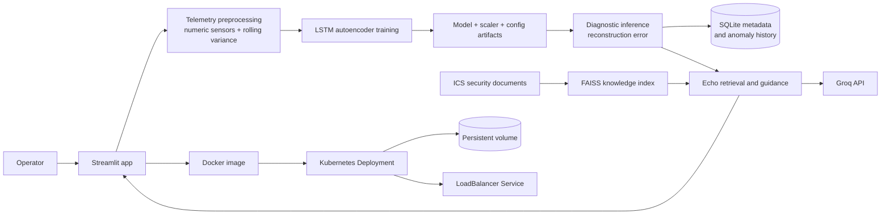

# Argus Echo

**An industrial AI/ML and MLOps portfolio project:** train facility-specific anomaly detectors, run telemetry diagnostics, and retrieve grounded operator guidance from ICS security documents.

Argus Echo combines a time-series machine-learning workflow with a containerized Streamlit application and a Kubernetes deployment. It is designed to demonstrate the full path from data and model artifacts to an operable application, while making the current production limitations visible.

> **Live demo:** Currently offline. Previous address: `http://34.121.158.211`.
>
> **Note:** Argus Echo was hosted on Google Cloud using the free allowance. Billing for the project has stopped, so the GKE service is offline. Restoring it requires an active billing account and may incur charges; some cloud resources may also need to be recovered. See [deployment recovery](docs/deployment-recovery.md) before attempting a redeploy.

[Watch the project walkthrough](https://www.loom.com/share/ae84ea9d2b4740f680059a0cd4ee66a7)

## Project at a glance

| Area | What this project demonstrates |
| --- | --- |
| AI/ML | LSTM autoencoder for time-series anomaly detection; telemetry preprocessing; rolling variance features; model, scaler, and configuration artifacts |
| MLOps | Per-user model records and artifacts; repeatable training and inference paths; row limits; health probes; persistent storage; a container build workflow |
| DevOps | Docker image; Kubernetes Deployment, Service, namespace, and persistent volume claim; resource requests and limits; readiness and liveness probes |
| Applied AI | Retrieval-augmented ICS guidance using a local vector index and Groq generation |

## User workflow

1. Create an account or log in.
2. Upload normal-operation telemetry and train a facility-specific LSTM autoencoder.
3. Upload telemetry for diagnostics and review reconstruction-error anomalies and history.
4. Ask Echo for an explanation grounded in the indexed ICS security corpus.

## Architecture



The application runs as a single Kubernetes replica today. SQLite and user artifacts are stored on a `ReadWriteOnce` persistent volume. This keeps the demo simple, but it limits horizontal scaling and concurrent write throughput. More detail is in [architecture and MLOps](docs/architecture-and-mlops.md).

## Repository map

```text
.
├── app.py                      Streamlit UI and user workflows
├── argus_model.py              Telemetry preprocessing and LSTM training
├── persistence.py              SQLite users, model metadata, and run history
├── argus_logger.py             Anomaly hint and local logging helpers
├── train_model.py              Command-line training entry point
├── echo/                       Retrieval, indexing, embeddings, and evaluation
├── data/                       ICS security and anomaly-detection references
├── k8s/                        Kubernetes namespace, deployment, and service
├── docs/                       Architecture, operations, and portfolio notes
├── .github/workflows/          Container build automation
├── Dockerfile                  Runtime container definition
└── requirements*.txt           Development and container dependencies
```

## Run locally

Requires Python 3.10+ and a Groq API key for generated Echo responses. Core model training and diagnostics do not require that key.

```powershell
python -m venv .venv
.\.venv\Scripts\Activate.ps1
pip install -r requirements.txt
$env:ARGUS_STORAGE_DIR = "ml"
$env:ARGUS_DB_PATH = "ml\argus_echo.db"
$env:GROQ_API_KEY = "your_groq_api_key"
streamlit run app.py
```

The app opens at `http://localhost:8501`. The local storage directory is ignored by Git.

## Build and deploy

GitHub Actions builds the Docker image on pushes to `main` and pull requests. It does not publish to a registry or deploy to a cloud account; deployment remains an explicit operator action.

```powershell
docker build -t argus-echo:local .
docker run --rm -p 8501:8501 -e GROQ_API_KEY=your_groq_api_key argus-echo:local
```

For GKE setup, secret creation, rollout, and public endpoint recovery, follow [deployment recovery](docs/deployment-recovery.md). Do not apply `k8s/secret.example.yaml` as a live secret: it contains a placeholder. Create the secret from your own API key as described in the runbook.

## Model and data notes

- Timestamp, date, time, and label-like columns are dropped; numeric sensor columns are retained.
- Rolling variance features are added per sensor.
- Training and diagnostic files must produce the same feature layout.
- Training and inference row caps default to 20,000 and can be configured through `ARGUS_MAX_TRAINING_ROWS` and `ARGUS_MAX_DIAGNOSTIC_ROWS`.
- The demo threshold and model quality need facility-specific validation before operational use. It is a portfolio/demo application, not a certified industrial safety system.
- User identity and operational metadata use SQLite; trained models and generated data live on local or mounted storage.

## Portfolio framing

This project can support applications for **AI/ML Engineer**, **DevOps Engineer**, and especially **MLOps Engineer** roles. The strongest story is the end-to-end path: data preparation, model training and inference, artifact persistence, application packaging, health checks, Kubernetes operations, and a retrieval-based AI feature.

See [portfolio and interview guide](docs/portfolio.md) for role-specific talking points, resume bullets, and an honest list of current gaps and next steps.

## Technology

Python · pandas · NumPy · TensorFlow/Keras · scikit-learn · Streamlit · SQLite · FAISS · LangChain · Groq · Docker · Kubernetes · Google Kubernetes Engine
